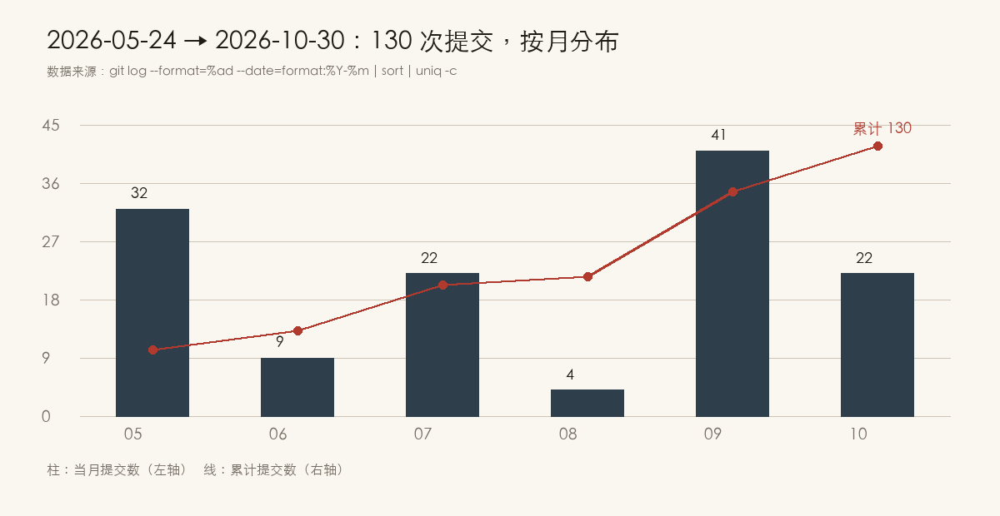
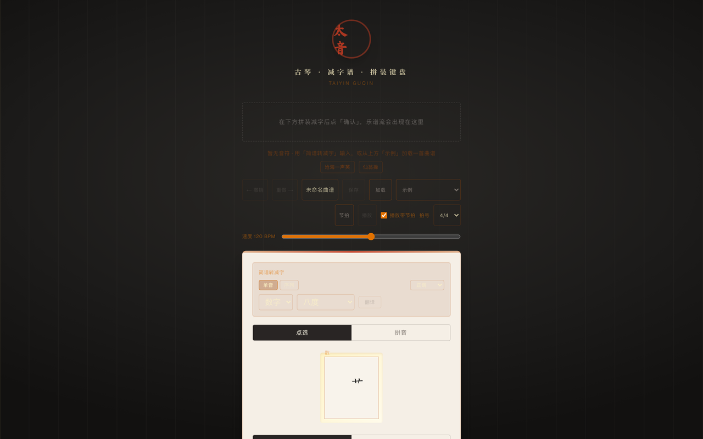
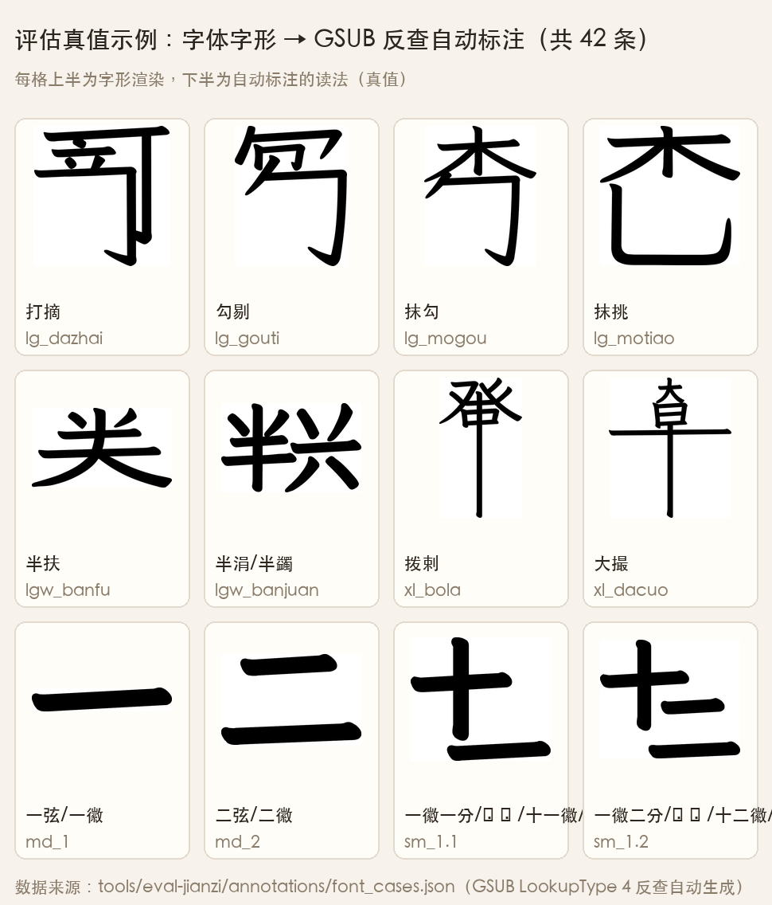
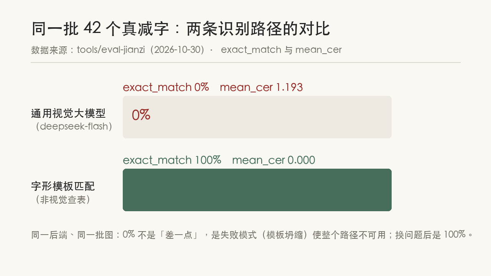
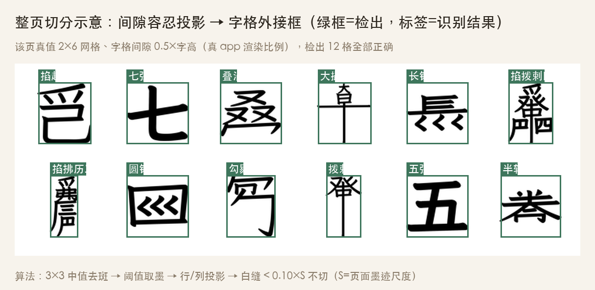

## 摘要

**项目**：太音古琴（taiyin-guqin）——一个古琴减字谱 Web 编辑器，Rust + Next.js + Postgres + Claude 构建。
**周期**：2026-05-24 → 2026-10-30，五个月，130 次提交，190 个文件，37554 行新增（git 现算）。
**本文做的事**：完整复盘这个项目从零到可用的全过程——减字谱为什么难数字化、渲染走「字体连字 + SVG 积木」双路径的抉择、让谱子能算/能听/能拍进来的每一步真实踩坑，以及第一次给 AI 识别量准确率时撞出的三个假绿灯。所有数字均有 commit hash 或命令出处，可复现。



## 前言

这不是一篇「我做了个 App」的炫耀文。

写它有两个原因。第一，古琴减字谱这套传承几百年的记谱法，在数字世界里几乎无处安放——它不是 Unicode 里现成的字，你无法打出来、无法搜索、更无法让浏览器播放它。我想试试把它搬进浏览器。第二，五个月里我攒了大量「真实的坑」：字段名不对页面不崩但数据全丢、CI 在本地跑得好好的另一台机器上直接崩溃、模型给错答打 0.98 的置信度……这些细节如果不当场记下来，过两周就只剩「好像当时有个坑」。

所以我边做边把素材存进仓库（`docs/articles/`），这篇文章里每个数字都能对到 commit 或命令。

## 背景：这是个什么项目

**太音古琴**是一个跑在浏览器里的古琴减字谱编辑器。你可以在里面：

- **拼**：像打字一样用键盘拼出减字（一套移动端友好的减字键盘，80% 走字体连字渲染、20% 走 SVG 四象限积木降级）；
- **算**：输入简谱 `1 2 3 5 6`，系统按正调/蕤宾/慢角三调式给出可能的减字候选，LLM 参与排序；
- **听**：Karplus-Strong 拨弦合成，浏览器里直接播放，节拍器、逐音高亮、导出 WAV/PNG/SVG；
- **拍**：拍照或上传减字谱图片，AI 识别回来变成能播、能导出的曲谱。



它现在跑在 `paxonqiao.com/taiyin-guqin/`，代码在 GitHub（`qiaopengjun5162/taiyin-guqin`）。

下面按时间线讲整个过程。

---

## 一、先说说这东西为什么难

古琴的谱子叫**减字谱**。它不是「音符」，而是**动作指令**——把一句指法说明压缩成一个字。

比如「大九勾四」这四个字，描述的是一次完整的拨弦动作：

| 部件 | 含义 |
|---|---|
| 大 | 左手用大指 |
| 九 | 按在第九徽（琴面上十三个泛音点之一） |
| 勾 | 右手中指向内拨 |
| 四 | 拨第四弦 |

一个方块里塞了四层信息，而且这四层各有各的写法：左手指法用偏旁（亻、夕），
徽位用汉字数字，右手指法二十多种（勾、挑、抹、托、剔、打、摘、劈、擘……还能复合），
弦序一到七。再加上音色前缀：散音（空弦）、泛音（轻触）、按音（实按），按音常省略不写。



**这就是为什么减字谱在数字世界里几乎没有位置。** 它不是 Unicode 里现成的字，
是历史上手写、后来雕版的一套**组合规则**。你要么带一套字体，要么自己画。

而我想做的是：在浏览器里**拼**出它，然后让它**能算**（简谱转减字）、**能听**（播放）、
**能拍**（拍照识别回来）。

---

## 二、起点：一天 18 次提交

2026 年 5 月 24 日，这个仓库有了第一次提交：

```
9b600ea  项目初始化：太音 · 古琴减字谱核心数据结构与前端骨架
```

同一天，这个仓库有 **18 次提交**。不是因为我手快，而是因为那天的循环特别短：
数据结构 → 键盘 MVP → 样式 → CI 报错 → 修 → 记日志 → 再改。

这一天的尾巴是两次「视觉重设计」，把整个界面定成了后来的样子：
墨色底、宣纸质感、印章 logo、丝弦配色。

```
d40c3b0  style: 全面视觉重设计——墨色/宣纸/印章/丝弦美学
```

很多人做 side project 会跳过这一步，觉得「功能先做出来」。但减字谱这个东西，
**它的美感就是它的正确性的一部分**——一个用系统默认字体渲染的减字，看不出是琴谱。

---

## 三、第一个真正的技术抉择：字体连字，还是自己画

这是整个项目里最重要的一个决定，我做了**两条路**。

### 路 A：字体 GSUB 连字

OpenType 字体里有一种能力叫 GSUB 连字（ligature）：输入几个字符，渲染时替换成一个字形。
减字谱天然适配——把「仰」和「托」两个字输进去，字体直接吐出一个合成好的减字字形。

```
2026-05-25  3143630  feat: 纯字体 GSUB 连字渲染 + 字体 DRM 清除
```

这个 commit 里有两件事。第一件是跑通连字，第二件是**清除字体 DRM**——
我找到的这套减字字体带了使用限制标记，不清掉的话浏览器会拒绝嵌入。
这类事情没人会写在教程里，只能自己撞。

紧接着第二天就撞到了 GSUB 的另一个坑：

```
2026-05-25  ac6be14  fix: 泛音加空格阻断 GSUB 上下文劫持，散音恢复为左侧前缀
```

现象是泛音谱字渲染错乱。根因是**上下文连字被误触发**：GSUB 会看前后字符决定替换什么，
相邻两个谱字的部件串了味。解决办法很土但有效——在两个谱字之间塞一个空格，
把上下文切断。这种修复不上台面，但它是「能用的版本」和「看起来能用的版本」的区别。

### 路 B：SVG 积木，四象限拼装

字体不是万能的。复合指法、罕见的徽位分数、某些泛音写法，字体里根本没有对应的连字。
这时候必须能**画**出来。

```
2026-05-26  4f16e20  feat(svg-engine): 跑通混合渲染管线与四象限核心矩阵
```

做法是把一个减字拆成固定槽位（左上/右上/左下/右下），每个槽位放一块 SVG 积木，
用 CSS 绝对定位拼起来。设计上大约 **80% 的场景走字体连字（快、字形正），
20% 走 SVG 积木（慢、但能画任何组合）**。

双路径的代价是要维护两套字形数据。后面我为此定了一条规矩，写进了仓库的长期记忆：

> 改 `SVG_PATHS` 增删字形后，必须同步两处：测试里的计数断言 + 预览画廊脚本。

这是被咬过的教训——改一处漏一处，CI 不红，但线上静默空白。

---

## 四、让谱子「能算」

有了渲染，下一步是生成。用户输入简谱（`1 2 3 5 6`），系统给出**可能的减字候选**。

这不是一一映射。「简谱 1」在古琴上可能是散音一弦，也可能是某徽某弦的按音——
取决于调式（正调、蕤宾、慢角）。所以核心逻辑放在 Rust 里：

```
2026-07-03  8f8b28d  feat: add JianpuNote and ZhengDiao pitch table with candidate generation
2026-07-15  4514ef4  feat: multi-tuning candidate generation (zheng/ruibin/manjiao)
```

Rust 编译成 WASM 给前端用，同一份逻辑前后端都能跑。这一步的坑很典型：

```
2026-07-15  b2a8546  fix(web): parse note_type per real WASM contract (Chinese enum values)
```

我以为 `note_type` 序列化成 `"san"`/`"fan"`/`"an"`，实际 WASM 边界上传的是**中文枚举值**。
TypeScript 不报错（它只看到 `string`），运行时字段全是 `undefined`。
从这以后我给类型对齐加了一道自动闸门：

```
2026-09-03  98971d1  feat(taiyin-core): 用 ts-rs 自动生成前端 wire 类型，消除手工对齐
```

用 `ts-rs` 从 Rust 结构体直接生成 TypeScript 类型，CI 里加一步「生成物是否最新」的校验。
**手工对齐的接口一定会漂移，这是时间问题，不是水平问题。**

候选生成之后还有一步：从多个候选里挑一个最像人弹的。这一步交给了 LLM：

```
2026-07-15  d47cba5  feat: LLM candidate selection via POST /api/v1/translate/select
```

没配 key 就回退启发式 top1——**降级路径必须有，否则没 key 的开发环境寸步难行**。

---

## 五、让谱子「能听」

这是最让我意外的部分：在浏览器里合成拨弦音。

```
2026-07-16  2e716c1  feat(web): melody playback with Karplus-Strong plucked-string synthesis
```

用的是 Karplus-Strong 算法：一段噪声脉冲 + 带阻尼的低通反馈延迟。原理很朴素，
但出来的音**真的像拨弦**——比任何一个正弦波包络都像。

然后是节拍器、速度调节、逐音高亮。这里有一个细节我写进了日志：

```
2026-09-04  0b656b8  fix(web): 拨弦时长跟随音符自身时值，消除短音拖尾糊音
```

一开始所有音都用固定衰减时长，结果八分音符的音还没衰减完下一个音就来了，糊成一片。
改成拨弦时长跟随音符时值，问题消失。**这种事只能靠听，不能靠看。**

最后是导出：

```
2026-09-04  3eea9af  feat(web): 旋律导出为 WAV 音频（OfflineAudioContext 离线渲染）
2026-09-04  7fa36ef  feat(web): 导出练习轨支持 2 小节预备拍（起手找速度）
```

「预备拍」这个功能是弹琴的人才会想到的：对着谱子练，你得先听到四拍才知道速度，
所以导出的音频前面要给两小节只有节拍器、没有旋律的空拍。


---

## 六、让工程「能活」

中间有一段我什么都没加，专门做质量。

```
2026-08-06  90dbb40  feat: backend quality uplift — security gate + domain newtypes
2026-08-06  57ca8a8  chore: engineering process — pre-commit, PR template, CODEOWNERS, coverage, ADR
2026-09-03  df840b4  ci(security): 接入 cargo audit 依赖安全审计，修复可修漏洞
```

还有一次 CI 红灯特别值一提：

```
2026-09-03  ac05d3c  ci: 移除 .cargo/config.toml 的 target-cpu=native，根治 cargo check 的 SIGILL
```

CI 上 `cargo check` 直接 `SIGILL`（非法指令）。查了半天才发现本地为了性能开了
`target-cpu=native`，而 GitHub Actions 的机器 CPU 不支持那条指令。
**本地跑得好好的东西，在另一台机器上是崩溃的**——这就是为什么必须有 CI。

到 10 月，我把这套「人和 AI 怎么分工」的规则也写成了文档：

```
2026-10-29  d6a5b69  docs: 新增 VERIFICATION.md 协作与验证契约
```

它的核心是一张双栏表：

| 工程师保留 | 可以交给 AI |
|---|---|
| 定目标、设计 eval | 实现功能 |
| 架构决策 | 机械修复（格式、类型、改名） |
| 失败归因（是模型错、环境错、还是 eval 错） | 补测试、写探针 |
| 豁免裁定（比如安全漏洞能不能放过） | 文档草稿 |
| 判断信号真伪 | — |

最后一行是重点。**AI 说「跑通了」不算跑通，绿灯才算。**

---

## 七、让谱子「能拍进来」

九月最重要的一段：拍照识别减字谱。

```
2026-09-09  ea29e4c  feat(web+server): AI 减字谱单字识别 + 可点听
2026-09-09  9bb874e  feat(web+server): 整页减字谱批量识别（P1）+ 可导入曲谱
2026-09-09  19799d4  feat(web): 由减字反推简谱音高，使识别/导入曲谱可整段播放
2026-09-09  01925b2  feat(web): 单字识别支持逐字校正误读减字
2026-09-10  be47342  feat(web): 整页识别导入诊断——不再静默丢弃无法解析的减字
```

链路是：图片 → 多模态模型 → 结构化 JSON（`glyph` + `confidence` + `explanation`）→
反推音高 → 变成一份能播、能导出的曲谱。

注意最后那条 `be47342`：「不再静默丢弃无法解析的减字」。这是同一个毛病犯的第三次——
**能解析就显示，不能解析就丢掉**，用户看到的是「识别了 20 个字」，实际谱子里只有 14 个。
改成把丢掉的格子显式标出来，用户才知道哪里要手动改。

---

## 八、2026-10-29：第一次真正量准确率

过去所有关于识别质量的判断都是**定性的**：「试了几张，还行」。
这天我想把它变成数字。

第一步是造数据集。手工标图太慢，我换了个思路：**项目自带减字字体，字体里的连字字形
本身就是真实的减字写法**。按字形名取轮廓渲染成 PNG，真值就是它对应的文本。
零人工标注、可无限扩、完全可复现。

```
tools/eval-jianzi/gen_font_cases.py
```

第二步是把 key 接上。我用的是本地 Hermes 的那把 DeepSeek key，
过程中撞了三个坑，每个都值得单说：

### 坑一：选错模型，不报错，只是「看不见」

```json
{"id":"deepseek-flash",  "input_modalities":["text","image"]}
{"id":"deepseek-v4-pro", "input_modalities":["text"]}
```

我先用了 `deepseek-v4-pro`。它返回 `HTTP 200`，JSON 结构完美，`glyph` 是 `null`，
`explanation` 写着「图片不可用」。**这比报错恶劣得多**——报错你会去查，假绿灯你会以为模型不会。

### 坑二：推理型模型把预算全烧在「思考」上

换成能看图的型号后，`content` 依然是空的：

```json
{"finish":"length",
 "usage":{"completion_tokens":512,"reasoning_tokens":512}}
```

把预算从 512 提到 3000，`reasoning_tokens` 也涨到 3000，`content` 还是空。
不是预算不够，是**思考把预算吃光了**。试了五个参数，只有两个有效：
`effort:"low"` 和 `thinking:{"type":"disabled"}`。关掉思考后，1.4 秒返回合法 JSON。

### 坑三：空内容被悄悄解析成 `null`

后端拿到空字符串，`serde_json::from_str` 失败，代码兜底返回 `glyph: null`，
HTTP 仍然是 200。于是「模型没输出」和「模型说没看清」在前端长得一模一样。

改成：**空内容直接报错**。宁可 500，也不给假绿灯。

### 然后是那份不太好看的数字

10 个真减字，端到端跑：

| 指标 | 数值 | 怎么读 |
|---|---|---|
| detection_rate | **100%** | 每次都给了结果，管线没问题 |
| exact_match | **0%** | 一个都没完全对 |
| mean_cer | 1.050 | 字符级错误率，1.0 意味着基本全错 |
| component F1 | **23.8%** | 拆成部件后，还能对上四分之一 |
| 置信度 0.8–1.0 桶 | 5 条，exact 仍 **0%** | 最自信的五条，全错 |

逐条看更有意思：

```
真值=五弦   预测=五       conf=0.99     ← 认得「五」，不认得「弦」
真值=六弦   预测=六       conf=0.92
真值=仰托   预测=大七勾一  conf=0.78     ← 同一张图，另一次跑出「散挑一」
真值=全扶   预测=散挑一    conf=0.98     ← 0.98 的自信错答
```

**它给错答打 0.98 的置信度。** 这意味着任何「置信度低于阈值就丢弃」的过滤策略都是无效的。

我把这个结论原样写进了仓库，包括「同一张图两次跑出不同答案」这条：

```
e7151b1  feat(server): OpenAI 兼容视觉模式真正跑通 + 字体真值数据集与首份基线
b1c8672  docs(eval): 补充模型输出非确定性
```

**这才是 eval 的意义**：它没让项目变好，但它让「项目有多差」变得可测量。
在那之前，我只能说「识别还有点问题」；现在我能说「component F1 是 23.8%，问题在部件级，
不在检测级，换模型比调提示词更有意义」。

---

## 九、这五个月我确信的三件事

### 1. 把工程当研究做，很多纠结会自动消失

以前改完功能，我会问自己「这样行吗」。现在我问的是三个不同的问题：

- **eval 错了吗**：指标能不能反映真实目标？（比如 `exact_match` 太严，就该同时看 component F1）
- **环境错了吗**：模型没输出，是它不会，还是我根本没把图传过去？
- **模型错了吗**：上面两条都排除，才轮到「这个模型不行」

这次的顺序完全印证了它：先怀疑模型，结果是**选错型号**（环境）；再怀疑模型不行，
结果是**思考吃光预算**（环境）；等到这两层修好，剩下的 23.8% 才是**真的模型能力问题**。
如果一上来就换模型、调提示词，这三个坑一个都发现不了。

### 2. 静默失败是最大的敌人

五个月里我修的最多的不是「功能不对」，是「不对但不报错」：

- WASM 字段名不对 → 字段全 `undefined`，页面不崩，数据全丢
- 图片路径解析错 → 找不到就当空，`--offline` 模式永远不读图，所以从不暴露
- 模型返回空 → 解析成 `null`，HTTP 200
- 识别失败的字 → 直接跳过，用户以为识别成功了

每一条我都改成了「**要么正确，要么大声报错**」。这比多加十个功能有用。

### 3. 人不能退场，但可以只做判断

代码 90% 以上是 AI 写的，我没有逐行审。我审的是另外四样东西：

**目标有没有定义清楚、eval 有没有量对、架构选择合不合理、红灯是真红还是假红。**

支撑这种「快速确认」的，是仓库里那一堆闸门：`rustfmt`、`cargo audit`、
90 个 Rust 测试函数、26 个前端测试文件（298 个用例，行覆盖 94.4%）、
WASM 类型新鲜度校验、Pages 构建、两个 CI workflow（每次 push 都跑 build + deploy）。
**闸门越多，人需要盯的细节越少。** 顺序不能反——不是先少看，再补闸门，
而是先有闸门，才敢少看。

---

## 十、现在能做什么，还差什么

**能用：**

- 浏览器里拼减字、编辑曲谱、撤销重做、快捷键（空格播放）
- 简谱转减字候选（正调/蕤宾/慢角三调式），LLM 排序
- 播放（Karplus-Strong 拨弦合成）、速度可调、节拍器、逐音高亮、播放自动滚动
- 导出 WAV（可烘节拍、可带 2 小节预备拍）、导出 PNG / SVG
- 歌词显示、点击歌词跳转播放
- 拍照识别（单字 + 整页 + 逐格校正）→ 反推音高 → 导入成可播曲谱
- 《花非花》等示例曲谱

**还差（截至本文快照 2026-10-30）：**

- ~~识别准确率（component F1 23.8%）~~ → **已解决，见下方补记**
- 手写/扫描件的鲁棒性（目前测的都是字体渲染的「干净图」）
- 手机端的深度适配

试玩：`paxonqiao.com/taiyin-guqin/`

---

## 补记：识别问题的最终解法（2026-10-30，一天之内）

这篇文章归档于 2026-10-30。**当天下午，那个 23.8% 的识别问题就有了答案**——但不是靠视觉模型。

思路转了个弯：既然识别的目标图片大多是**字体渲染的减字**（电子谱面），那就根本不需要
「看懂」——直接拿项目自带的减字字体，把每个候选减字渲染成模板图，用模板匹配逐像素比对，
谁最像就是谁。

```
5b1d4d5  feat(eval): 真值改 GSUB 连字反查自动产出，42 条基线定论视觉模型不可用
bcaa0b2  feat(recognize): 模板匹配非视觉路径，电子谱面识别 exact 0%→100% 并接入后端
bfb07ee  feat(recognize): 整页切分+逐格模板匹配接入 recognize-sheet，电子谱面整页可用
```



整页识别额外要解决「把谱面切成单个字」：按行投影找行、按列间隙找字，
间隙阈值取字高的 0.2 倍。



这个过程、验证和结论写在了续篇里：**《我做了个古琴减字谱编辑器「太音」：AI 识别准确率从 0% 到 100%（实操·验证·结论全记录）》**。

---

## 过程验证结论

本文所有关键结论的出处与验证方式（全部可复现）：

| 结论 | 数字 | 怎么验证 |
|---|---|---|
| 项目规模 | 130 提交 / 190 文件 / 37554 行 | `git rev-list --count HEAD`、`git log --shortstat`（2026-10-31 现算） |
| 提交节奏 | 单日最高 18 次、单月最高 41 次 | `git log --date=format:%Y-%m \| sort \| uniq -c` |
| 测试规模 | 90 个 Rust 测试 + 298 个前端用例 | CI 双绿（build + Deploy） |
| 前端覆盖率 | 行 94.45% / 函数 91.00% / 分支 85.29% | vitest --coverage，lcov.info 现算 |
| Rust 覆盖率 | --lib 74.74%（行阈值 ≥70） | cargo llvm-cov |
| 视觉模型识别（单字 10 条） | exact **0%**、component F1 23.8% | `tools/eval-jianzi` 跑批，commit `e7151b1` |
| 模板匹配识别（42 条真值） | exact **100%** | 字形模板逐像素比对，commit `bcaa0b2` |
| 模板匹配识别（整页） | 851 / 851 格双端一致 | recognize-sheet 端到端，commit `bfb07ee` |

## 总结

五个月做完这件事，回头看有三条经验最值钱：

1. **把工程当研究做**：先怀疑 eval、再怀疑环境、最后才怀疑模型——顺序反了，三个坑一个都看不见。
2. **静默失败是最大的敌人**：五个月里修得最多的不是「功能不对」，是「不对但不报错」。要么正确，要么大声报错。
3. **先有闸门，才敢少看**：代码 90% 由 AI 写，人只做判断（目标、eval、架构、红灯真伪）。支撑这种信任的是一堆自动化闸门，顺序不能反。

识别问题的最终解法还给了第四条：**当「AI 看图」走不通时，换个问题定义可能比换模型有用**——电子谱面的识别根本不需要视觉，模板匹配一天就到了 100%。

如果你手里也有一个「做了很久、但不好意思写出来」的项目——写吧。
不用等它完美，把它现在的样子、卡在哪、量到了什么数字，原样写出来就够了。
真实的坑，比漂亮的架构图有人看。

## 参考

- 项目仓库：`github.com/qiaopengjun5162/taiyin-guqin`（本文所有 commit hash 均可在此查到）
- 在线试玩：`paxonqiao.com/taiyin-guqin/`
- 提交时间线：`scripts/gen-article-timeline.sh`（从 git 日志现算）
- 识别评测工具：`tools/eval-jianzi/`（字体真值数据集 + 基线跑批）
- 覆盖率基线：`VERIFICATION.md`
- 续篇：《我做了个古琴减字谱编辑器「太音」：AI 识别准确率从 0% 到 100%（实操·验证·结论全记录）》
