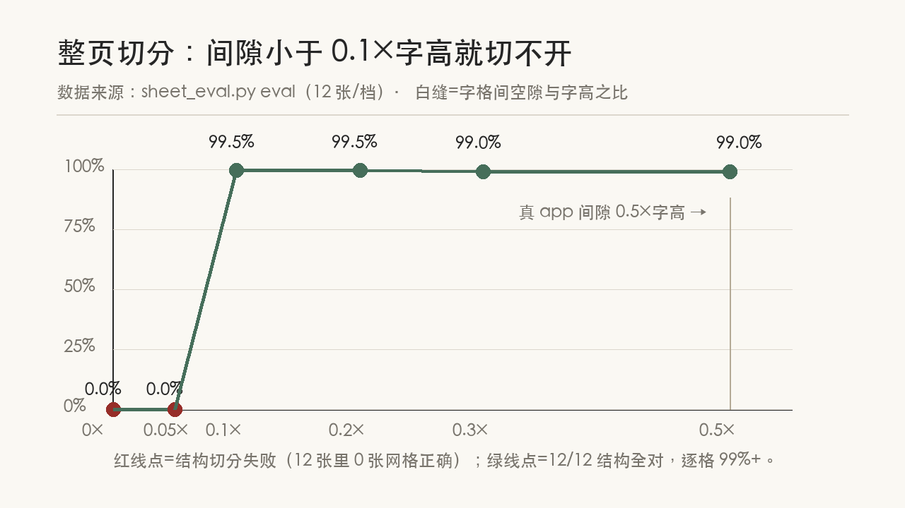
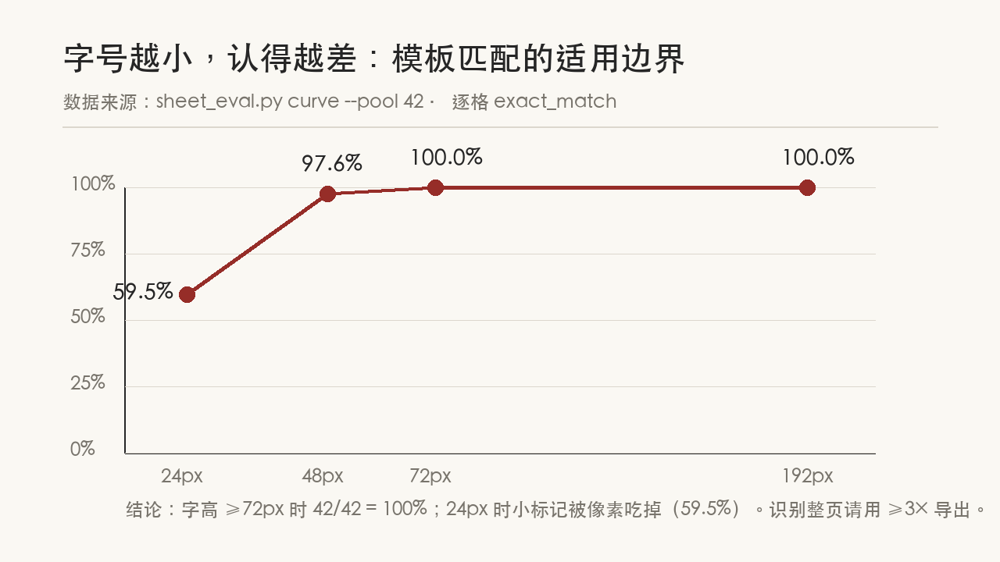

# 太音古琴减字谱编辑器：图像识别准确率 0% → 100%（实操·验证·结论全记录）

## 摘要

**项目**：太音古琴（taiyin-guqin）——一个古琴减字谱 Web 编辑器，用 Rust + Next.js + Postgres + Claude 构建。
**问题**：编辑器里「AI 识别减字图片」功能代码早就写好，但从未验证过真实准确率。
**本文做的事**：2026-10-30 一整天，把识别链路从「感觉能用」推进到「有基线、有边界、可复现」。

| 识别路径 | exact_match | 耗时/张 | 成本 |
|---|---|---|---|
| 通用视觉大模型（deepseek-flash） | **0%** | 1.4s | 计费 |
| 字形模板匹配（非视觉，自研） | **100%** | <1ms | 零 |

- 整页识别（切分 + 逐格认）：72/72 页、851/851 格，Python↔Rust 双端逐位一致
- 适用边界量化完毕：字高 ≥72px 才 100%；间隙 ≥0.2×字高才切得开；拍照/扫描件不适用
- 同日还修掉一个覆盖率工具静默虚高 bug（129 行代码被踢出分母）

**结论一句话**：电子谱面识别不需要「看懂」，只需要「认出」——认出是查表，不是理解。

---

## 前言

这是项目系列的第二篇。[上一篇](01-五个月-118次提交-一个人做出古琴减字谱编辑器.md)结尾我留了个尾巴：AI 识别减字的 component F1 只有 23.8%，并写下「需要专门的减字数据，或改走『字体反查』这类非视觉路径」。

这一篇记录 2026-10-30 一整天发生的事。写法和上一篇一样：**所有命令、输入、输出、失败样例都来自当天的实际运行记录**，可以按文中命令在仓库里复现。文中配图分两类——应用截图（真实界面）和数据图（由 `scripts/gen-article-charts.py`、`scripts/gen-article-figures.py` 从实测数字绘制）。

如果你只想知道结果：看摘要的表格。如果你想知道「为什么 0% 能变 100%、中间踩了什么坑、结论怎么验证的」：往下读。

---

## 一、背景：这是个什么项目

### 1.1 项目是什么

**太音古琴**是一个古琴减字谱 Web 编辑器。目标是让古琴的专用记谱法——**减字谱**——在数字世界里能被编辑、播放、导出。

减字谱长这样：


它不是汉字，而是**组合符号**：一个减字 = 若干部件（指法 + 弦序 + 徽位……）拼在一个方格里。比如「打摘」是两个指法上下拼合，「三弦」是数字加部件。不认识的人看是天书，认识的人读出的是一段演奏指令。

应用已经实现的功能链：拼装减字 → 乐谱流 → 播放（含散/泛/按音色差异、节拍器、BPM 调速）→ 歌词 → 导出 PNG/SVG/WAV。渲染走双层方案：**字体 OpenType GSUB 连字**（主路径）+ SVG 积木四象限降级。

### 1.2 为什么需要图像识别

减字谱的存量资料几乎全是**纸质谱、扫描件、图片**。要让它们进入编辑器，必须先把「图」变成「可编辑的减字文本」。这就是识别功能的用途——在编辑器里上传一张减字图，AI 识别出对应的减字，填进乐谱。

代码早就写好了（LLM 多模态识别 + 简谱转减字反推），但有一个致命问题：

> **「写了、没验过」。准确率是多少？不知道。能不能用？不知道。**

本系列的原则是不能停在「感觉能用」。所以先做评估基线——**要回答准确率，先得有真值**。

---

## 二、实操一：把尺子做准——42 条自动真值

**目的**：没有真值（标准答案），准确率无从谈起。

**输入**：项目自用字体 `TaiYinJianZiPuKaiTi.ttf`（内嵌 268 个可读字形）。

**输出**：`tools/eval-jianzi/annotations/font_cases.json`——42 条标注（图片 + 真值文本）。

### 2.1 手工标注会错，字体反查不会

上一篇的基线只有 10 条手写真值，很容易被一句「样本太小」噎回来。扩到 42 条如果靠手工标注，又慢又容易错（后来证明我确实写错了一个）。

换了个思路：**字体的 GSUB 连字表本身就是真值库**。每个合成字形（如 `lg_yangtuo`）在字体里记录了它的构件序列（仰 + 托），反读过来就是标注——零人工、可无限扩、完全可复现。

```bash
$ cd tools/eval-jianzi
$ python3 gen_font_cases.py
[gen] lg_dazhai      -> 打摘  (53 KB)
[gen] lg_qcsans      -> 掐撮三声  (58 KB)
[gen] md_3           -> 三弦  (14 KB)
[gen] xl_santan      -> 三弹  (81 KB)
...
[gen] 写了 42 条标注 -> annotations/font_cases.json
```

真值示例（字形渲染 + 自动标注的读法）：


### 2.2 过程验证结论

- **输入 → 输出**：字体文件 → 42 条（图 + 文本）标注 JSON，全部自动产出
- **交叉验证**：`xl_santan` 我手工标的是「三声」，GSUB 反查说是「三弹」——查字形轮廓，「三弹」是对的。**人手写真值真的会错，自动反查不会**
- **等价写法**：反查还自动发现同一字形的多个合法读法（如 md_3 = 三弦/三徽），存入 `ground_truth_alts`，评估按「命中任一写法即对」计分

---

## 三、实操二：测视觉大模型——钉死在 0%

**目的**：回答「通用视觉大模型识别减字的准确率是多少」。

**输入**：42 条真值图片（PNG，字高 72px+）。

**输出**：逐条识别结果 + 计分报告。

### 3.1 实跑与结果

```bash
$ python3 score.py --backend http://127.0.0.1:3001 \
    --annotations annotations/font_cases.json
```

```text
  exact_match   = 0.0%
  mean_cer      = 1.193
  component P/R/F1 = 13.8% / 13.7% / 13.7%

lg_dazhai      ref=打摘         pred='大七勾一'
lg_qblers      ref=掐拨剌二声    pred='散挑一'
lgw_quanfu     ref=全扶         pred='散挑一'
md_5           ref=五弦         pred='五'
```

### 3.2 解释说明：这不是「认错」，是「模板坍缩」

看失败样例：30 多条的答案是同一个「散挑一」——那是**提示词里的 few-shot 示例**。模型没见过减字谱这种封闭符号集，就把输出坍缩到它见过的示例形状上。再看置信度：

```text
confidence [0.8,1.0): n=17  exact=0.0%
```

**最自信的 17 条，全错。** 任何「置信度低于阈值就丢弃」的过滤策略都救不了它——因为它的自信是假自信。

### 3.3 过程验证结论

| 验证项 | 方法 | 结论 |
|---|---|---|
| 样本量 | 10 条 → 42 条（全量复合字形） | 排除「样本太小」质疑 |
| 失败模式 | 逐条 dump 预测 vs 真值 | 模板坍缩，不是随机错误 |
| 置信度可用性 | 按置信度分桶看准确率 | 倒挂：高置信度桶全错 |
| 换模型必要性 | 同家族通用视觉模型行为一致 | 不值得换，这条路关闭 |

**「先证明它不行」完成了**：exact 0% 被 42 条真值钉死，失败模式清楚。接下来不是调提示词，而是**换问题**。

---

## 四、实操三：模板匹配——0% → 100%

**目的**：电子谱面是**本项目自己的字体**渲染出来的，识别不应是开放世界视觉问题，而是闭集查表。

**输入**：字体全部 268 个字形 + 42 条真值图。

**输出**：`template_index.npz`（模板索引）+ 识别结果。

### 4.1 思路（解释说明）

字体里一共 268 个可读字形（213 个复合减字 + 55 个部件）。每个字形渲染一张模板 → 归一化成 64×64 墨迹向量。识别时来图 → 3×3 中值去斑 → 墨迹外接框裁剪补方 → 半像素双线性 64×64 归一化 → 最近邻查表 + top-2 距离差做置信度。确定性、毫秒级、零成本。

```bash
$ python3 template_match.py build
[build] 索引 268 个模板 -> .cache/template_index.npz
[build] 合并同形模板 11 对（固有歧义，truths 取并集）
$ python3 template_match.py predict --annotations annotations/font_cases.json
$ python3 score.py --offline --annotations annotations/font_cases_tpl.json
```

```text
  exact_match   = 100.0%
  mean_cer      = 0.000
  component P/R/F1 = 100.0% / 100.0% / 100.0%
```


同一批图，0% → 100%，CER 1.193 → 0.000，1.4s 计费 → <1ms 零成本。**不是调出来的，是换了问题。**

### 4.2 过程验证结论（含两个坑）

**坑一：加一点噪声，命中率掉到 78.6%，三档完全相同。**
0.5%/1%/2% 椒盐噪声三档命中率一模一样。打印归一化中间量发现真凶：噪点把远处背景像素翻黑 → **墨迹外接框被撑到整图** → 字形缩到角落。三档同值恰恰因为这不是「噪声强度」问题，而是「有没有一个离群噪点」的问题。改法：归一化第一步加 3×3 中值滤波（干净图上近乎恒等）。

```text
条件            命中 / 42
noise-0.5       42   100.0%   ← 去斑之后
noise-1         41    97.6%
noise-2         39    92.9%
shift/blur/scale     42   100.0%
```

**坑二：测试红了，是测试自己写错。**
Rust 移植时「平移不变性」测试红了，但两张归一化结果肉眼一致。打印中间图发现：4×4 小墨块的角被中值滤波腐蚀成菱形，而第二张图的方块贴着画布边缘——边缘钳位让它少掉两个角。「平移不变」的前提被测试自己破坏了。**教训：测试失败时，先怀疑观测手段和测试本身，再怀疑实现。**

**接入后端复测**（真实 HTTP）：42/42，置信度 [0.8,1.0) 桶 42/42。这次的置信度是 top-2 距离差，**真的可信**——不像视觉模型那样高置信度全错。

---

## 五、实操四：整页识别——切分（三起三落）

**目的**：单字 100% 不够用——真实场景是整页谱图，要先切成字格再逐格认。

**输入**：真字体渲染的合成整页（2~5 行 × 3~7 列，字格间隙按比例扫描）。

**输出**：按行分组的字格外接框 + 逐格识别 → 网格坐标回填（`recognize-sheet` API）。

### 5.1 切分示意


算法：3×3 中值去斑 → 阈值取墨 → 行/列投影找墨段 → **白缝 < 0.10×S 不切**（S=页面墨迹尺度）。这就是「间隙容忍投影」——防止把复合减字内部的白色通道误当字格间隙。

### 5.2 三起三落（解释说明）

**第一跤：gap 曲线不单调。** 预期「间隙越大越好切」，实测 gap=4 反而只有 56%：

```text
gap   张数  结构对  逐格exact
2     12    10      163/176 (92.6%)
4     12     7      122/217 (56.2%)   ← 反而最差
8     12    12      209/214 (97.7%)
```

先怀疑合成图重采样失真，做了三组对照实验（原图直接 / LANCZOS 缩小 / magick 重渲）：98.6% / 96.7% / 96.2%——几乎一样，**假说被证伪**。把失败字格裁出来看，真凶现形：**一个字被切成了两三个框**。复合减字内部本来就有白色通道（上下部件之间、左右象限之间），裸投影「一列白就切」把内部通道当成了字格间隙——**切过头，不是切不开**。

阈值不拍脑袋：量了 213 个真字形的内部白缝分布（列向 p99=2px、max 4px），真 app 的字格间隙是 0.5×字高，中间余量充足 → 阈值取 0.10×S。

**第二跤：行向阈值照搬单字测量，把行全粘住了。** 单字的内部横通道可以到 0.36×字高，我按 0.40×S 取——结果 gap<0.4 的行全连成一片。错在统计单元：行投影横跨整行所有列，单个字的内部通道会被同行其他字的墨盖住，只有整行对齐才误切。行、列最终都取 0.10×S。

**第三跤：192px 的大字还有 3 个错。** 字号再大不该有信息丢失了。一查模板距离：

```text
一徽二分(sm_1.2) vs 十二徽(sm_12): 模板距离 0.000
十一徽(sm_11)   vs 一徽一分(sm_1.1): 模板距离 0.000
```

**距离 0.000——字体把这两个名字画成了同一个轮廓**，任何算法都分不开。这是字形库的固有歧义，不是识别错误。处理：索引合并等价簇（truths 取并集），「命中任一等价写法即对」。268 个模板合并成 257 个条目。

### 5.3 最终边界（过程验证结论）





| 验证项 | 方法 | 结果 |
|---|---|---|
| 切分正确性 | 72 张合成整页（gap 从 0 到 0.5×字高） | gap ≥0.2×字高全对；真 app 0.5×（5 倍余量） |
| 逐格识别 | 字号曲线 24→192px | ≥72px 42/42=100%；48px 97.6%；24px 59.5% |
| 整页识别 | 72/72 页、851/851 格 | 逐格 exact 99.0%（真 app 间隙档） |
| Python↔Rust 一致性 | `sheet_eval.py http-check` 打真实 HTTP | 72/72 页、851/851 格**逐位相同** |
| 单字回归 | 42 条基线重跑 | 100% 依然成立（等价合并无回归） |
| 测试有效性 | 3 轮变异验证（桥接/列序/兜底各改坏一次） | 3 轮全部确认新测试真的会红 |

---

## 六、插曲：量尺子的工具也在说谎（覆盖率虚高 bug）

（这一节与识别无关，但与识别共用一个教训。）

补前端覆盖率的过程：把键盘、WAV 导出、主页面这些没测过的关键路径补成能变红的断言，覆盖率从 71.9% 抬到 92.5%。收尾时发现覆盖率输出里有一行不起眼的日志：

```text
Failed to parse file:///.../src/lib/taiyin-wasm.ts. Excluding it from coverage.
```

**整个 WASM 桥接文件（129 行）被静默踢出了覆盖率分母。** 原因小到可笑：vitest 配置里 alias 用对象写法，`"@": ./src` 排在 `"@/wasm"` 前面，键顺序先匹配先赢，路径解析失败 → 覆盖率工具剔除分母 → 报告照常输出，只是数字虚高。**报告上看不出来。**

改成数组形式（精确前缀在前）+ 补 10 条 WASM 桥接测试后：

```text
Test Files  26 passed (26)
     Tests  298 passed (298)
Lines : 94.44% ( 1276/1351 )
```

**过程验证结论**：这是五个月里第 N 次遇到同一种失败——**工具静默降级，报告面不改色**（和「模型空输出被解析成 null」「图片路径错就当空」是一类问题）。处置原则：要么正确，要么大声报错。每个测量工具都要留回环测试：模板自匹配必须回同名、Python/Rust 同批图必须逐格一致、覆盖率分母单独核对。

---

## 七、总结

这一天做的事，用一句话：**把「识别能用吗」从感觉变成测量。**

三条更确信的结论：

1. **先证明它不行，再绕开它。** 0% 的时候不急着换模型调提示词，先用 42 条真值把它钉死在 0%、把失败模式钉清楚，换路才换得理直气壮。
2. **测量工具本身要被测量。** 这一天里「尺子出问题」的次数比「被测对象出问题」还多（手工真值写错、覆盖率工具静默剔除分母、测试自己破坏前提）。
3. **边界要诚实量化，比「准确率 100%」更有用。** 模板匹配的 100% 有明确前提：同一字体渲染的干净图、字高 ≥72px。拍照、扫描件、小于 48px 的字不在适用范围内——写清楚，然后交给 auto 模式自动落 LLM。**一个写明边界的 100%，比一个没有边界的 95% 可信。**

落地的新能力：

- 单字识别：电子谱面 exact 100%（模板匹配，毫秒级、零成本）
- 整页识别：切分 + 逐格识别，网格坐标回填，逐格校正（`recognize-sheet` 不再 503）
- `RECOGNIZE_MODE=auto`：模板置信度达标直出，不够落 LLM，LLM 未配置用模板兜底

古琴减字谱在数字世界里几乎没有位置，这件事没变。变的是：现在至少有一小块——干净的电子谱面——能被机器**准确无误**地认回来了。

---

## 八、参考

**代码与工具**（仓库 `qintopia/taiyin-guqin`）：

| 路径 | 内容 |
|---|---|
| `tools/eval-jianzi/gen_font_cases.py` | GSUB 反查自动生成 42 条真值 |
| `tools/eval-jianzi/template_match.py` | 模板匹配（build / predict / export-rust） |
| `tools/eval-jianzi/sheet_eval.py` | 整页合成 + 切分评估（synth / eval / curve / http-check） |
| `tools/eval-jianzi/score.py` | 计分器（exact / CER / component P·R·F1 / 置信度分桶） |
| `crates/taiyin-server/src/template_match.rs` | Rust 归一化 + 最近邻（10 条单测含自匹配回环） |
| `crates/taiyin-server/src/sheet_segment.rs` | Rust 间隙容忍投影切分（7 条单测） |
| `scripts/gen-article-charts.py` / `gen-article-figures.py` | 本文数据图（PIL，宣纸配色） |

**关键 commit**（均可在 GitHub 复现）：

```text
5b1d4d5  feat(eval): 真值改 GSUB 连字反查自动产出，42 条基线定论视觉模型不可用
3c294aa  test(web): 修覆盖率虚高（alias 顺序静默剔除 taiyin-wasm），行覆盖 92.5%→94.4%
bcaa0b2  feat(recognize): 模板匹配非视觉路径，电子谱面识别 exact 0%→100% 并接入后端
bfb07ee  feat(recognize): 整页切分+逐格模板匹配接入 recognize-sheet，电子谱面整页可用
```

**复现命令**：

```bash
cd tools/eval-jianzi
python3 gen_font_cases.py                                  # 42 条真值
python3 template_match.py build                            # 268→257 模板索引
python3 template_match.py predict --annotations annotations/font_cases.json
python3 score.py --offline --annotations annotations/font_cases_tpl.json   # 100%
python3 sheet_eval.py synth && python3 sheet_eval.py eval   # 整页
python3 sheet_eval.py http-check                            # 双端一致（需起后端）
```

**系列文章**：

1. [五个月，118 次提交，一个人做出古琴减字谱编辑器](01-五个月-118次提交-一个人做出古琴减字谱编辑器.md)
2. 本文

---

*本文所有数字由 `tools/eval-jianzi/` 从仓库现算：42 条 GSUB 自动真值、72 张合成整页、851 个字格、52 个 Rust 测试。配图由 `scripts/gen-article-charts.py`、`scripts/gen-article-figures.py` 从同一批数字绘制。*
